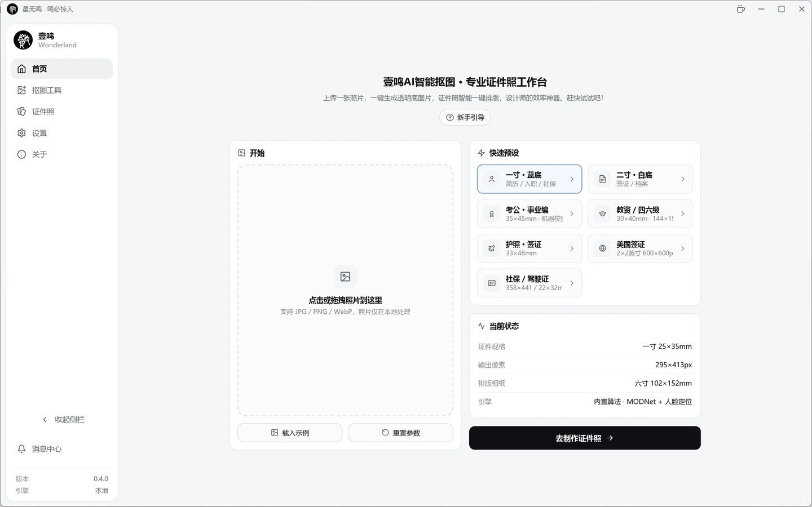
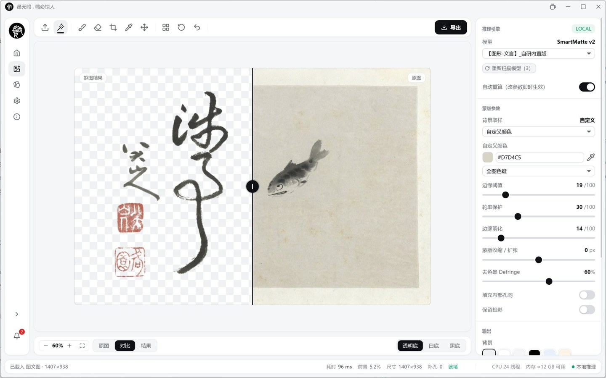
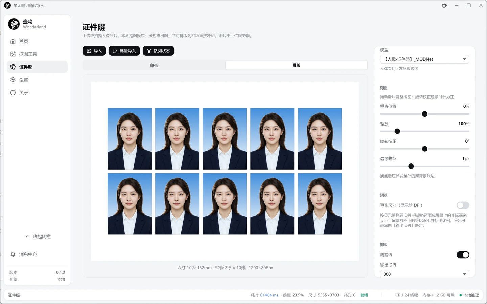

<div align="center">

# 壹鸣 WonderLand

**本地优先的智能抠图与证件照工作站 · Rust + iced 原生桌面应用**

*无 WebView · 无 Electron · 无上传 · 图片永不离机*

[](LICENSE)
[](#系统要求)
[](https://www.rust-lang.org/)
[](https://github.com/iced-rs/iced)
[](#安装)

</div>

---

壹鸣（WonderLand）是一款纯 Rust 构建的桌面图像工具，包含两大工作台：

- **🧩 抠图工具** —— 一键移除图片背景：内置自研几何算法与多个 SOTA 开源分割模型（MODNet / BiRefNet / BEN2 / InSPyReNet / U²-Net），配合画笔修边、裁剪旋转、批量队列，产出透明底 PNG / JPG / WEBP
- **📸 证件照** —— 20 种规格（14 毫米制 + 6 像素制）+ 7 种官方底色 + 5 种渲染模式，本地人像抠图换底，单张导出与相纸排版一次完成

所有推理与图像处理**全部在本机完成**：不上传、无遥测、无广告、离线可用。

> [!NOTE]
> 当前版本面向 **Windows 10 / 11（x64）**。UI 由 [iced 0.14](https://github.com/iced-rs/iced) 经 wgpu 直接绘制，不依赖任何浏览器组件。

## 🖼️ 应用预览

| 首页 · 新手引导与快速预设 | 抠图工具 · 对比视图与画笔修边 | 证件照 · 换底与相纸排版 |
|---|---|---|
|  |  |  |

---

## ✨ 功能特性

### 🧩 抠图工具

| 功能 | 说明 |
|---|---|
| **双引擎抠图** | 几何算法（色距 + 梯度 + 自适应多趟阈值，纯 CPU 毫秒级）与 ONNX 神经网络（DirectML GPU 加速，CPU 自动回退）按需切换 |
| **5 个开源模型** | MODNet（人像发丝级）/ BiRefNet（通用高精度）/ BEN2（电商产品）/ InSPyReNet（高分辨率）/ U²-Net（轻量快速） |
| **画笔修边** | 保留 / 擦除双画笔，大小 / 不透明度 / 流量 / 硬度可调 |
| **吸管取样** | 画布上直接指定背景关键色 |
| **裁剪与旋转** | 自由裁剪框 + 比例锁定，90° 旋转与任意角度校正 |
| **历史撤销** | 深度 3 的快照式撤销栈 |
| **批量队列** | 多图排队处理、逐项状态、失败容错与重试、并行管线、自定义输出目录 |
| **导出** | PNG（透明）/ JPG / WEBP，尺寸与背景色可控 |

### 📸 证件照

| 功能 | 说明 |
|---|---|
| **20 种规格** | 毫米制 14 种 + 像素制 6 种，覆盖一寸 / 二寸 / 签证 / 社保 / 考试等常用场景 |
| **7 种官方底色** | 标准白 · 标准蓝 · 考公蓝 · CET 浅蓝 · 申根灰 · 标准红 · 档案红 |
| **5 种渲染模式** | 纯色 / 上下渐变 / 中心渐变 / 透明底 / 保留原背景 |
| **人像抠图换底** | MODNet 本地推理，发丝级边缘 |
| **相纸排版** | 六寸 / 五寸 / 七寸 / A4，横竖朝向自动取张数多者 |
| **输出 DPI 可调** | 300 / 600 DPI（毫米制规格按 DPI 换算物理尺寸） |

### 🖥️ 应用体验

- **主题系统**：亮色 / 暗色 / 跟随系统 + 自定义强调色，持久化记忆
- **中英双语**：一键切换，全界面覆盖（含通知与错误提示）
- **通知系统**：系统通知 + 应用内消息中心（未读徽标、免打扰时段）
- **批量体验**：拖拽导入、处理进度、加载动画、Toast 提示
- **自绘标题栏**：与应用主题同色，原生规格窗口控制
- **分步新手引导**：首次进入首页自动弹出，可跳过或不再显示

### 🔒 隐私承诺

> **所有功能完全免费、没有广告，图片处理全程留在你的电脑上，不上传任何数据。**
> 打赏完全自愿，不升级、不解锁、不影响任何功能。

---

## 🚀 安装

### 方式一：下载预编译包（推荐）

前往 [**Releases**](https://github.com/laosan-x/Yiming/releases) 下载最新安装包：

- `cocole-iced-v0.4.6-setup.exe` —— NSIS 安装器，双击安装（内置 3 个轻量模型：YuNet 人脸检测 / MODNet / U²-NetP，约 40 MB）

> **大模型按需加载**：高精度模型（BiRefNet 927 MB / BEN2 212 MB / InSPyReNet 170 MB）不随安装包分发。
> 在安装目录（或仓库根目录）执行 `powershell -ExecutionPolicy Bypass -File models\download.ps1` 下载后放入 `models/` 文件夹，应用会自动识别新模型。

### 方式二：从源码构建

**环境要求**

| 依赖 | 版本 | 说明 |
|---|---|---|
| [Rust](https://rustup.rs/) | ≥ 1.82（MSVC 工具链） | `rustup default stable-x86_64-pc-windows-msvc` |
| Visual Studio Build Tools | 2019+ | MSVC 链接器（随 Rust MSVC 工具链安装） |
| Git | 任意近期版本 | 克隆仓库 |

```bash
git clone https://github.com/laosan-x/Yiming.git
cd Yiming

cargo build --release
# 产物：target/release/cocole-iced.exe（约 15 MB，GUI 子系统）
```

> [!TIP]
> 首次构建需编译 iced + wgpu 依赖链（约 300 个 crate），冷构建需数分钟，请耐心等待。

**推理运行时（可选，启用神经网络抠图时需要）**

程序按 `load-dynamic` 方式加载 ONNX Runtime，无需编译期链接：

1. 从 [onnxruntime releases](https://github.com/microsoft/onnxruntime/releases) 下载 `onnxruntime-win-x64`（≥ 1.16）
2. 将 `onnxruntime.dll` 放入可执行文件同目录的 `ort-libs/` 文件夹
3. 将模型权重（`.onnx`）放入 `models/` 文件夹（下载地址见下方[模型说明](#模型下载)）

> 缺少 DLL 或模型时，程序自动退回纯 CPU 几何算法，功能不受影响。

**NSIS 安装包打包（可选）**

```bash
cargo build --release
# 组装暂存目录后执行（脚本自动从 Cargo.toml 读版本并传给 makensis）
pwsh -File scripts/build-installer.ps1
# installer.nsi 从 dist/cocole-iced-v<版本>-windows-x64/ 取文件
```

---

## 📖 使用说明

### 快速上手

```bash
cocole-iced                  # 正常启动
cocole-iced <图片路径>        # 启动后直接载入该图并自动抠图
```

1. **首页** —— 点虚线框或拖入照片开始；新手引导会分步高亮各功能区
2. **抠图工具** —— 选模型（下拉框）→ 点「抠图」→ 画笔修边 → 裁剪导出
3. **证件照** —— 选规格与底色 → 换底 → 微调构图（缩放 / 垂直偏移）→ 单张或排版导出
4. **设置** —— 主题 / 语言 / 计算后端 / 快捷键 / 更新日志

### 模型下载

神经网络抠图的权重文件不入库，**一键下载（推荐）**：

```powershell
powershell -ExecutionPolicy Bypass -File models\download.ps1
# 或只下某个模型：-Only modnet
```

脚本内置全部官方源（已验证可达），自动跳过已存在的文件。各模型也可手动获取：

| 文件 | 来源 |
|---|---|
| `modnet.onnx` | [MODNet](https://github.com/ZHKKKe/MODNet)（社区 ONNX 转换：[Xenova/modnet](https://huggingface.co/Xenova/modnet)） |
| `birefnet_1024.onnx` | [BiRefNet](https://github.com/ZhengPeng7/BiRefNet)（官方 ONNX：[releases v1](https://github.com/ZhengPeng7/BiRefNet/releases/tag/v1)） |
| `BEN2_Base.onnx` | [BEN2](https://huggingface.co/PramaLLC/BEN2) |
| `model_fp16.onnx` | [InSPyReNet](https://github.com/plemeri/InSPyReNet)（官方无 ONNX 发布，可用同架构的 [isnet-general-use.onnx](https://github.com/danielgatis/rembg/releases/download/v0.0.0/isnet-general-use.onnx)） |
| `u2netp.onnx` | [U²-Net](https://github.com/xuebinqin/U-2-Net)（官方权重：[rembg 托管](https://github.com/danielgatis/rembg/releases/tag/v0.0.0)） |
| `face_detection_yunet_2023mar.onnx` | [OpenCV Zoo](https://github.com/opencv/opencv_zoo) |

可通过环境变量 `COCOLE_MODEL_DIR` 指定自定义模型目录。

### 配置文件

所有参数（主题、语言、抠图参数、证件照选项等）实时持久化到：

```
%APPDATA%\yiming\cocole-iced\config\config.json
```

配置损坏时自动回落默认值，不会导致启动失败。

---

## ❓ 常见问题（FAQ）

<details>
<summary><b>启动时闪现黑色窗口？</b></summary>

v0.4.0 已修复（根因是启动期查询注册表的方式不当，现改为原生 API 直读）。若仍遇到，请确认使用的是最新 Release 包；debug 构建（`cargo run`）按设计保留控制台以便查看日志。
</details>

<details>
<summary><b>神经网络模型加载失败 / 提示找不到模型？</b></summary>

依次检查：① `ort-libs/onnxruntime.dll` 是否存在且版本 ≥ 1.16；② `models/` 下是否有对应 `.onnx` 文件（注意文件名与上表一致）；③ DirectML 显存不足时会自动回退 CPU 并在日志提示，属正常行为。
</details>

<details>
<summary><b>没有独立显卡能用吗？</b></summary>

能。DirectML 不可用时自动回退纯 CPU 推理；几何算法引擎完全不依赖 GPU，商品图毫秒级出结果。
</details>

<details>
<summary><b>界面是英文的，怎么切回中文？</b></summary>

设置 → 外观与通知 → 语言 → 中文。同理可切换主题模式与强调色。
</details>

<details>
<summary><b>配置文件在哪？想重置所有设置？</b></summary>

`%APPDATA%\yiming\cocole-iced\config\config.json`。关闭应用后删除该文件即可恢复出厂设置。
</details>

<details>
<summary><b>批量处理后输出到哪了？</b></summary>

默认写到源目录旁的 `out/` 子目录（文件名 `<原名>_nobg.<ext>`）；也可在批量面板中自定义输出目录。
</details>

---

## ⚙️ 系统要求

| 项目 | 最低要求 | 推荐配置 |
|---|---|---|
| 操作系统 | Windows 10（x64） | Windows 11 |
| 内存 | 4 GB | 8 GB+（大模型推理） |
| 显卡 | 无要求（CPU 回退） | DX12 GPU（DirectML 加速） |
| 磁盘 | 300 MB（程序） | + 模型权重数百 MB |
| 显示器 | 1024×640 最小窗口 | 1440×900+ |

---

## 🧱 技术栈

| 层 | 选型 |
|---|---|
| 语言 | Rust（Elm 架构，`Task`/`Message` 单向数据流） |
| GUI | [iced](https://github.com/iced-rs/iced) 0.14 + wgpu 渲染，无 WebView |
| 推理 | [ort](https://github.com/pykeio/ort)（ONNX Runtime，DirectML EP，CPU 回退） |
| 图像处理 | `image` crate（解码 / 编码 / 旋转 / 缩放），自研抠图内核 `core/matting.rs` |
| 平台 API | `windows-rs`（注册表 / DWM / 时间）、`rfd`（原生文件对话框） |
| 持久化 | `serde_json` → 系统配置目录 |
| 打包 | NSIS 3.10 |

架构概览：

```
src/
  main.rs            入口：CJK 字体加载 + 应用启动
  app.rs             顶层 App 状态 + update 分发 + view 组装
  message.rs         Message 枚举（Elm 消息流）
  theme.rs           设计 token：颜色 / 圆角 / 尺寸 / 全部 widget 样式
  core/              与 UI 无关的内核（matting / idphoto / image / config / nn / i18n / notify）
  ui/                每页一个模块（update + view）：home / work / idphoto / settings / about
```

---

## 🤝 鸣谢 / Acknowledgements

本项目的抠图能力建立在以下开源模型之上，权重版权归各自上游项目所有，请遵循各自许可证使用（建议从官方渠道获取权重文件并放入 `models/`）。

### 模型致谢

| 模型 / 项目 | 作者 | 许可证 | 在本项目中的用途 |
|---|---|---|---|
| [MODNet](https://github.com/ZHKKKe/MODNet) | Zhanghan Ke 等，香港城市大学 | Apache-2.0 | 人像发丝级 alpha 抠图，证件照换底主力（512 输入） |
| [BiRefNet](https://github.com/ZhengPeng7/BiRefNet) | Peng Zheng 等 | MIT | 通用生活场景高精度抠图（1024 输入） |
| [BEN2](https://github.com/PramaLLC/BEN2)（[HuggingFace](https://huggingface.co/PramaLLC/BEN2)） | Prama LLC | MIT（Base 版） | 电商产品图 / 通用背景移除（1024 输入） |
| [InSPyReNet](https://github.com/plemeri/InSPyReNet) | Taehun Kim 等，POSTECH | MIT | 高分辨率显著目标抠图（1024 输入） |
| [U²-Net / u2netp](https://github.com/xuebinqin/U-2-Net) | Xuebin Qin 等 | Apache-2.0 | 轻量 CPU 档通用抠图，秒级出图（320 输入） |
| [YuNet](https://github.com/opencv/opencv_zoo) / [libfacedetection](https://github.com/ShiqiYu/libfacedetection) | Shiqi Yu 团队 · OpenCV Zoo 团队 | Apache-2.0 / MIT | 人脸检测，证件照头部定位与构图校验 |

对应论文：

- Ke et al., *MODNet: Real-Time Trimap-Free Portrait Matting via Objective Decomposition*, AAAI 2022
- Zheng et al., *Bilateral Reference for High-Resolution Dichotomous Image Segmentation*, CAAI AIR 2024
- Kim et al., *Revisiting Image Pyramid Structure for High Resolution Salient Object Detection*, ACCV 2022
- Qin et al., *U²-Net: Going Deeper with Nested U-Structure for Salient Object Detection*, Pattern Recognition 2020

### 框架与工具致谢

| 项目 | 许可证 | 用途 |
|---|---|---|
| [Rust](https://www.rust-lang.org/) | MIT / Apache-2.0 | 开发语言 |
| [iced](https://github.com/iced-rs/iced)（含 winit / wgpu） | MIT | 原生 GUI 框架（Elm 架构，0.14） |
| [ONNX Runtime](https://github.com/microsoft/onnxruntime) | MIT | 推理引擎（DirectML GPU 加速，经 [ort](https://github.com/pykeio/ort) 绑定） |
| [windows-rs](https://github.com/microsoft/windows-rs) | MIT / Apache-2.0 | Win32 API（注册表 / DWM / 时间） |
| [image](https://github.com/image-rs/image) | MIT / Apache-2.0 | 图像解码 / 编码 / 缩放 |
| [tokio](https://github.com/tokio-rs/tokio) | MIT | 异步运行时（任务通道 / 定时器） |
| [serde / serde_json](https://github.com/serde-rs/serde) | MIT / Apache-2.0 | 序列化与配置持久化 |
| [rfd](https://github.com/PolyMeilex/rfd) | MIT | 原生文件对话框 |
| [notify-rust](https://github.com/hoodie/notify-rust) | MIT / Apache-2.0 | 系统通知 |
| [Lucide](https://github.com/lucide-icons/lucide) | ISC | 界面图标（内联 SVG 字形） |
| [NSIS](https://nsis.sourceforge.io/) | zlib | Windows 安装包制作 |

> 📋 **完整许可清单**：全部 577 个第三方组件（含传递依赖）的许可证与来源见 [THIRD-PARTY-NOTICES.md](THIRD-PARTY-NOTICES.md)——均为宽松许可证（MIT × 425、Apache-2.0 × 72、MIT/Apache 双许可 × 3、Zlib × 18、Unicode-3.0 × 18、BSD 系 × 19、ISC × 4、其余复合许可若干），可放心集成。

再次向所有上游作者与社区贡献者表示感谢——壹鸣只是站在这些巨人肩膀上的一层薄薄的应用。

### 支持项目

壹鸣 **免费 · 无广告 · 本地隐私**。如果它帮到了你，欢迎：

- 点一下**标题栏右上角的 ☕**，请作者喝杯咖啡（[爱发电](https://afdian.com/a/laosan) / [Ko-fi](https://ko-fi.com/laosan)）；
- 或者花 **0 元**给项目一个 [**Star ⭐**](https://github.com/laosan-x/Yiming)，同样是很好的支持。

---

## 📜 许可证 / License

本项目代码以 [Apache-2.0](LICENSE) 许可证开源：

- ✅ 允许商用、修改、再分发（需保留许可证与版权声明）
- ✅ 附带明确的**专利授权**条款，对基于开源模型构建的应用更稳妥
- ⚠️ 模型权重（`models/`）**不在本许可证覆盖范围内**，版权归各自上游项目，请遵循其原始许可证获取与使用（见「鸣谢」）

```
Copyright 2026 laosan-x (壹鸣 WonderLand)

Licensed under the Apache License, Version 2.0 (the "License");
you may not use this file except in compliance with the License.
You may obtain a copy of the License at

    http://www.apache.org/licenses/LICENSE-2.0
```
